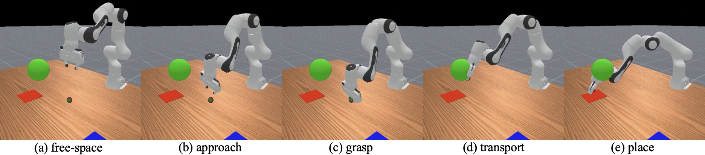
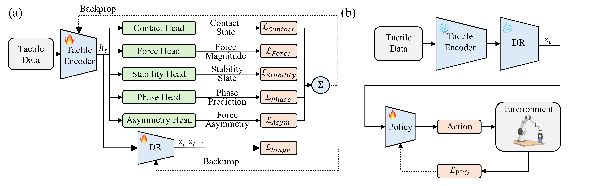

# Task-Aligned Tactile Representation Learning for Robotic Manipulation

**IEEE ROBIO 2026** · Min Joong Kim\*, Zhengrong Ling\*, Yajing Shen · The Hong Kong University of Science and Technology
<br>\* Equal contribution

Code and data for **Task-Aligned Tactile Representation Learning for Robotic
Manipulation**.

<p align="center">
  
</p>

We pre-train a tactile encoder that compensates for the object-pose information lost
to visual occlusion during contact-rich manipulation. A robot cannot see an
object once its gripper closes around it; the encoder turns the raw contact
forces into a representation the downstream policy can act on.

## Methods

<p align="center">
  
</p>


1. **Data-driven auxiliary-head selection** - auxiliary supervision targets are
   *derived from expert rollouts* by a discriminability-and-learnability
   criterion, rather than hand-picked. Five factors pass (contact, bilateral
   force symmetry, grasp stability, manipulation phase, force magnitude); slip
   prediction is rejected as not learnable from force history.
2. **A gated hinge temporal-consistency loss** - a phase-gated, squared
   margin penalty that compresses within-phase latent oscillation while leaving
   phase transitions unpenalized, keeping the representation stable enough for RL
   without flattening the phase information the policy needs.
3. **Frozen Deployment** - After pre-training, the heads are discarded, and the encoder is  frozen. PPO trains the policy solely on z<sub>t</sub>, requiring no auxiliary labels during policy learning.

## Key results

Policy success across **N** independent PPO training runs per condition, evaluated on 10 evaluation seeds of 620 episodes each (all runs reported).

| Condition | Tactile input to the policy | Success, mean (range) % | N |
|---|---|---|---|
| Oracle | current 6-D force, plus the true object pose and grasp flag | 94.88 (94.69–95.06) | 2 |
| **Encoder (ours)** | 16-D latent of the last 16 force frames | **91.66 (90.71–92.35)** | 3 |
| Raw Tactile | current 6-D force | 82.71 (79.42–84.97) | 3 |
| Raw Tactile Stack | last 16 force frames, flattened (96-D) | 82.74 (81.21–85.16) | 3 |
| Visual-only | none | 67.66 (64.48–70.84) | 2 |

- **Gap Closure:** The Encoder recovers 88% of the performance gap between Visual-only and Oracle baselines (measured from run means).
- Every Encoder run outperforms every run of the raw-tactile variants - the lowest-performing Encoder run ($90.71\%$) comfortably exceeds the highest raw-tactile run ($85.16\%$).
- **Learned Structure vs Temporal Context:** Temporal context alone is insufficient. Extending the policy's input to match the Encoder's 16-frame window leaves Raw Tactile performance unchanged ($82.7\%$ in both cases), confirming that performance gains stem from the learned representation rather than history depth.
- **Reproducibility:** The Encoder achieves the highest reproducibility across retraining, exhibiting a standard deviation across runs of just $0.85$ points, compared to $2.91$ and $2.12$ points for the baselines.

<details>
<summary><b>Every training run</b></summary>

| Condition | Training seed | Success, mean ± SD over 10 evaluation seeds (%) |
|---|---|---|
| Oracle | 4796 | 95.06 ± 0.94 |
| Oracle | 1 | 94.69 ± 1.35 |
| Encoder (ours) | 4796 | 91.92 ± 1.31 |
| Encoder (ours) | 1 | 90.71 ± 1.08 |
| Encoder (ours) | 4 | 92.35 ± 0.85 |
| Raw Tactile | 4796 | 79.42 ± 2.41 |
| Raw Tactile | 1 | 83.73 ± 1.18 |
| Raw Tactile | 4 | 84.97 ± 1.39 |
| Raw Tactile Stack | 4796 | 85.16 ± 0.64 |
| Raw Tactile Stack | 1 | 81.85 ± 2.11 |
| Raw Tactile Stack | 4 | 81.21 ± 1.01 |
| Visual-only | 4796 | 70.84 ± 1.61 |
| Visual-only | 1 | 64.48 ± 1.92 |
 
Training seeds are matched across conditions
</details>

### Where the gain concentrates
Success by object category, mean $\pm$ SD across training runs (%):
| Category | Oracle | Encoder (ours) | Raw Tactile | Raw Tactile Stack | Visual-only |
|---|---|---|---|---|---|
| Symmetric / uniform (22 objects) | 96.1 ± 0.0 | **94.2 ± 1.4** | 90.4 ± 1.9 | 92.0 ± 0.6 | 89.5 ± 0.4 |
| Thin / elongated (11 objects) | 89.3 ± 1.3 | **82.9 ± 1.2** | 73.3 ± 9.5 | 76.7 ± 2.1 | 15.4 ± 1.5 |
| Irregular (29 objects) | 96.1 ± 0.1 | **93.0 ± 0.5** | 80.4 ± 1.5 | 78.0 ± 4.9 | 70.9 ± 9.3 |

- **Symmetric Objects (+3.8 vs single-frame, +2.2 vs stacked)** 
- **Thin / Elongated Objects (+9.6 vs single-frame, +6.2 vs stacked)**
- **Irregular Objects (+12.6 vs single-frame, +15.0 vs stacked)**
- **Consistency:** These performance gains are uniformly positive across every training seed and object category.


## Repository structure

```
env/                          Simulation environment (PickAndPlaceYCBToTray task)
tactile_encoder/              Encoder architecture + pre-training
training/                     PPO training script
evaluation/                   Multi-seed evaluation + seed-level statistics
analysis/                     Figure generation + probes (all analysis scripts)
data/encoder_pretraining/     Expert-rollout pre-training data (.h5; Hugging Face)
data/v2/                      Deployment records (.npz) read by the analysis scripts
checkpoints/                  Final encoder + policy checkpoints
results/                      Evaluation and latent space analysis results
```                    

## Installation
Requires an NVIDIA GPU (simulator running on GPU PhysX) and Python ≥ 3.10

```bash
python -m venv .venv && source .venv/bin/activate
pip install -r requirements.txt
```

## Pre-training Data

**Pre-training data (Hugging Face).** The expert-rollout dataset used to
pre-train the encoder (`clean.h5`, `low_friction.h5`, `noisy.h5`; ~8.5M
timesteps across 62 YCB objects) is hosted on Hugging Face. Clone it into
`data/encoder_pretraining/`:

```bash
git clone https://huggingface.co/datasets/kingIronMan777/phase-aware-tact-pretraining-data \
    data/encoder_pretraining
```

This data is only needed to **retrain the encoder from scratch** (stage 1). To
reproduce the figures and numbers, the pre-trained checkpoints below are
sufficient and the pre-training data is not required.

## Reproducing the paper

The pipeline has four stages. To reproduce **the figures and numbers only** (no
retraining), skip to stage 4 - the shipped checkpoints and deployment `.npz`
files are sufficient.

### 1. Pre-train the tactile encoder

Requires the pre-training data from Hugging Face (see *Pre-training Data*
above), placed in `data/encoder_pretraining/`.

```bash
python tactile_encoder/train_tactile_encoder.py \
        --data-dir data/encoder_pretraining \
        --output-dir runs/tactile_encoder_v2 \
        --epochs 30 \
        --batch-size 512 \
        --lr 1e-3 \
        --w-temporal 0.5
# produces the hinge encoder; set --w-temporal 0 for the no-hinge ablation
```

Optionally verify the data reproduces the head-selection analysis
(symmetry separation, slip non-learnability, class balance):

```bash
python tactile_encoder/analyze_encoder_data.py \
    --data-dir data/encoder_pretraining --window-size 16
```

### 2. Train the ablation policies

The observation condition is set with `--experiment-mode`:
 
| `--experiment-mode` | Paper condition | Checkpoint name |
|---|---|---|
| `oracle` | Oracle | `policy_oracle` |
| `visual_encoder` | Encoder (ours) | `policy_encoder` |
| `visual_raw_tact` | Raw Tactile | `policy_raw_tactile` |
| `visual_raw_tact_stack` | Raw Tactile Stack | `policy_raw_tactile_stack` |
| `visual_only` | Visual-only | `policy_visual_only` |

```bash
COMMON="--env_id=PickAndPlaceYCBToTray-v1 --num-envs 4096 --num-steps 16 \
        --num-eval-envs 8 --num-eval-steps 100 --update-epochs 8 \
        --num-minibatches 32 --total-timesteps 35000000 --gamma 0.93 \
        --track --capture-video --save-model"

# Training seed 4796
python training/ppo.py $COMMON --seed 4796 --experiment-mode oracle --exp-name policy_oracle
python training/ppo.py $COMMON --seed 4796 --experiment-mode visual_encoder --exp-name policy_encoder
python training/ppo.py $COMMON --seed 4796 --experiment-mode visual_raw_tact --exp-name policy_raw_tactile
python training/ppo.py $COMMON --seed 4796 --experiment-mode visual_raw_tact_stack --exp-name policy_raw_tactile_stack
python training/ppo.py $COMMON --seed 4796 --experiment-mode visual_only --exp-name policy_visual_only
 
# Training seeds 1 and 4 (Oracle and Visual-only: seed 1 only)
python training/ppo.py $COMMON --seed 1 --experiment-mode oracle --exp-name policy_oracle_seed1
python training/ppo.py $COMMON --seed 1 --experiment-mode visual_only --exp-name policy_visual_only_seed1
for s in 1 4; do
  python training/ppo.py $COMMON --seed $s --experiment-mode visual_encoder --exp-name policy_encoder_seed$s
  python training/ppo.py $COMMON --seed $s --experiment-mode visual_raw_tact --exp-name policy_raw_tactile_seed$s
  python training/ppo.py $COMMON --seed $s --experiment-mode visual_raw_tact_stack --exp-name policy_raw_tactile_stack_seed$s
done
```

### 3. Evaluate

```bash
python evaluation/evaluation.py                      # all 13 runs; resumes if interrupted
python evaluation/per_category_analysis.py           # Table III
python evaluation/per_object_runs.py --object wrench # adjustable-wrench example
```

Raw Output & Reproducibility: Every episode's details (condition, evaluation seed, object, episode, success) are saved to results/downstream_performance/multiseed_eval_all_raw.csv so all stats can be recomputed from scratch.

### 4. Collect Deployment Data && Generate numbers and statistics 

```bash
# Deployment records (1,000 episodes each) -> data/v2 (hinge) and data/v1 (no hinge)
python analysis/collect_.py --policy checkpoints/policy_encoder.pt \
    --encoder checkpoints/tactile_encoder_hinge/best_encoder.pt --tag v2 --num-episodes 1000 --seed-start 0
python analysis/collect_.py --policy checkpoints/policy_encoder_no_hinge.pt \
    --encoder checkpoints/tactile_encoder_no_hinge/best_encoder.pt --tag v1 --num-episodes 1000 --seed-start 0
 
python analysis/latent_space_analysis.py       
python analysis/plot_transport_dz.py           
python analysis/verify_hinge_margin_claim.py    
python analysis/plot_grasp_asymmetry.py         
python analysis/probe_grasp_outcome.py          
python analysis/probe_transport_functional.py 
```

The above figure script also writes its underlying data as `.csv` under `results/`, so
plots can be regenerated in any tool without rerunning the pipeline.

## Method notes

- **Occlusion model.** The observed object position is blended toward the tool
  center point as the gripper closes, `p̂ = (1−α)·p_obj + α·p_tcp`, degrading
  rather than removing the privileged signal so that cross-condition differences
  isolate the tactile representation.
- **Encoder.** A temporal CNN over a 16-frame force window → 16-dimensional
  latent `z_t`. Auxiliary heads are used only in pre-training and discarded at
  deployment; the policy consumes only `z_t`.
- **Gated hinge loss.** The penalty is `s_t · [max(0, ‖z_t − z_{t−1}‖₂ − m)]²`,
  averaged over same-phase consecutive pairs, where the gate
  `s_t = 1[phase_t = phase_{t−1}]` excludes transition pairs entirely and the
  squared hinge is zero below the margin `m`. So once oscillation is small the
  temporal penalty switches off and the auxiliary-head objectives shape the
  representation unopposed. Within-phase oscillation compresses ~16×; phase
  transitions stay proportionally distinct (transition/within-phase
  step-distance ratio preserved, 8.8× → 10.7×) because the gate never penalizes
  them and the auxiliary heads require phase-distinct latents — structure an
  always-on L2 penalty would erode.
- **Statistics.** Success rates are calculated separately for each evaluation seed (620 episodes; 10 per object). Each training run is summarized by the mean $\pm$ SD across its 10 evaluation seeds. For between-condition comparisons, training runs are the unit of analysis; we report the mean and range of the run-level means. Per-object and per-category success rates use the same per-seed aggregation. Success–failure comparisons of force and latent statistics—grasp asymmetry and transport $\| \Delta z_t \|$—use two-sided Mann–Whitney *U* tests on per-episode values.

## Implementation Details
<details>
<summary><b>Encoder, auxiliary heads, and labels</b></summary>

**Encoder (29.6k parameters).** The encoder takes a smoothed force window of shape 16 × 6. It applies three Conv1d → LayerNorm → GELU blocks with 32, 64, and 64 channels, respectively. Each convolution uses a kernel size of 3 and padding of 1. After temporal mean pooling, a Linear(64, 64) → LayerNorm → GELU block produces the 64-dimensional representation h<sub>t</sub>. A final Linear(64, 16) layer produces z<sub>t</sub>.

The auxiliary heads operate on h<sub>t</sub> and use small MLPs with dimensions 64 → 32 → output, except for the force-magnitude head, which uses 64 → 16 → 1. All auxiliary heads are discarded after pre-training.

| Head / objective | Target at step t | Loss | Weight |
|---|---|---|---|
| Contact | Simulator grasp state, determined by the ManiSkill grasp check | BCE with a positive-class weight of 0.24 | 1 |
| Asymmetry  | Absolute difference between the raw left and right force norms, divided by their sum | MSE on a sigmoid output; contact steps only | 2 |
| Stability | 1 if the object remains grasped from t through t + 14, inclusive (a 15-step horizon); 0 otherwise | Focal loss (α = 0.25, γ = 2); contact steps only | 1 |
| Phase | Simulator-derived phase: free, grasp (lifted < 3 cm), transport (lifted ≥ 3 cm), or post-slip (released after a grasp) | Cross-entropy | 0.5 |
| Force magnitude | log(1 + ‖x<sup>raw</sup><sub>t</sub>‖) / 6.5 | MSE | 0.3 |
| Temporal hinge | Consecutive windows in the same phase, with margin m = 0.5 | Squared hinge loss | β = 0.5 |

**Class balance.** 80.6% of timesteps are in contact (`analysis/pretraining_data/class_balance_report.txt`). Only 5.2% of grasped timesteps are unstable; this imbalance limits the stability head’s F1 score (approximately 0.43). The phase distribution is 15.9% free, 30.9% grasp, 49.7% transport, and 3.5% post-slip. The rejected slip target has a positive rate of 3.9% and achieves an F1 score of 0.09 using a 16-frame window (`temporal_discriminability.txt`).

Contact, phase, and stability labels rely on privileged simulator state. These labels are required only for offline pre-training.
</details>

<details>
<summary><b>Pre-training</b></summary>

- **Data:** Training data are collected from an oracle-mode PPO expert (checkpoints/dataGen_policy.pt) using deterministic actions under three conditions: clean (200 batches), action noise (σ = 0.15; 83 batches), and low friction (μ = 0.3; 50 batches). Each batch contains 256 parallel episodes of 100 steps, yielding 8,524,800 timesteps in total.

- **Samples:** A sample is constructed at every episode step t ≥ 16 and paired with the window ending at t − 1 for the temporal hinge loss. Trajectories are split into training and validation sets at a 90/10 ratio using seed 42.

- **Optimization:** Both encoders are trained for 30 epochs with AdamW, a weight decay of $1 × 10^-5$, a batch size of 512, and gradient-norm clipping at 1.0. The learning rate follows a cosine schedule that decays to zero over the full training run, starting at $1 × 10^-3$ for the hinge encoder and $3 × 10^-4$ for the no-hinge encoder, as recorded in their respective train_log.csv files. The checkpoint with the lowest validation loss is saved as best_encoder.pt.
</details>

<details>
<summary><b>PPO</b></summary>

| Setting | Value |
|---|---|
| Parallel environments × rollout length | 4096 × 16 (batch 65,536) |
| Minibatches × update epochs | 32 (2,048 each) × 8 |
| Total environment steps | 35M (534 iterations) |
| Discount γ / GAE λ | 0.93 / 0.9 |
| Optimizer | Adam, learning rate 3e-4 (constant), ε 1e-5 |
| Clip / value coefficient / entropy coefficient | 0.2 / 0.5 / 0 |
| Max gradient norm / target KL | 0.5 / 0.1 |
| Advantage normalization | on |
| Networks | separate actor and critic MLPs, 3 × 256, tanh, orthogonal init |
| Policy | Gaussian, state-independent log-std (initialized at −0.5) |
| Checkpoint | final (`final_ckpt.pt`), evaluated with deterministic (mean) actions |
 
The observation modality is the only difference between conditions.
</details>

## Checkpoint naming

- policy_{oracle,encoder,raw_tactile,raw_tactile_stack,visual_only}.pt — seed 4796
- policy_{oracle,visual_only}_seed1.pt, policy_{encoder,raw_tactile,raw_tactile_stack}_seed{1,4}.pt — retraining runs
- policy_encoder_no_hinge.pt — policy on the no-hinge encoder (hinge ablation, step 4)
- dataGen_policy.pt — oracle expert used to collect pre-training data

## Acknowledgments

The simulation environment and PPO training build on
[ManiSkill3](https://github.com/haosulab/ManiSkill) (Tao et al., RSS 2025),
running on the [SAPIEN](https://sapien.ucsd.edu/) physics engine (Xiang et al.,
CVPR 2020). Our policies adapt the ManiSkill PPO baseline
([examples/baselines/ppo](https://github.com/haosulab/ManiSkill/tree/main/examples/baselines/ppo)),
which is itself based on [CleanRL](https://github.com/vwxyzjn/cleanrl)
(Huang et al., 2022) and implements PPO (Schulman et al., 2017); we modified it
to consume the frozen tactile latent `z_t` as an observation. ManiSkill is
released under the Apache-2.0 license; the adapted `training/ppo.py` retains its
original notices.

## Citation

If you use this code, please cite our paper:

```bibtex
@inproceedings{kim2026taskaligned,
  title     = {{Task-Aligned Tactile Representation Learning for Robotic Manipulation}},
  author    = {Min Joong Kim and Zhengrong Ling and Yajing Shen},
  booktitle = {IEEE International Conference on Robotics and Biomimetics (ROBIO)},
  year      = {2026}
}
```

## License
This project is released under [LICENSE](LICENSE).
